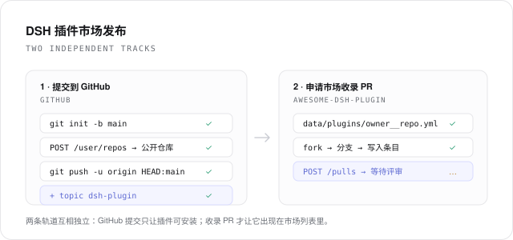

# 【南山】DSH插件市场发布助手

左侧栏插件：扫描本机正在开发的 DSH 组件，按官方
[contributing.md](https://github.com/awesome-dsh-plugin/awesome-dsh-plugin/blob/main/contributing.md)
分两条**互相独立**的轨道引导发布：

1. **GitHub 提交** —— 初始化仓库、创建公开仓库、提交推送、添加 `dsh-plugin` topic。
2. **市场收录 PR** —— 生成 `data/plugins/<owner>__<repo>.yml`，fork 官方列表仓库、写入条目、开 PR，并跟踪 CI 与 `held: author` 状态。

两条轨道各自有独立的进度与按钮：只做完 GitHub 提交，组件已经是可安装的公开仓库；再做收录 PR，市场里才能搜到它。



## 功能

- **组件发现**：自动发现本机档案里以 `link:` 安装的 DSH 组件，以及打开的 workspace；也可以点「选择文件夹」调起**系统原生文件夹选择器**，选中任意组件目录后加入清单（校验 `package.json` 里是否有 `dsh.bundle` / `dsh.client`）。原生选择器不可用时（例如某些远程页面）才会退回手工输入绝对路径。
- **官方预检**：把 contributing.md 里会被 CI 与人工评审检查的项目逐条算成清单——`dsh.bundle` 声明、真实代码、仓库公开、满 1 天、`dsh-plugin` topic、分类取值、英文描述必填与句号、描述含营销词、图标必须是 GitHub 托管的位图、tarball 链接、monorepo 子包路径、官方包需用 `peerDependencies` 等。
- **一键动作**：初始化仓库、创建并推送、提交并推送、加 topic、提交收录 PR，背后是 `git` 与 GitHub REST API。
- **傻瓜式引导**：7 步流程，只把「下一个还没完成的动作」放大显示，做完一步自动推进。
- **PR 跟踪**：PR 状态、CI 检查项、标签（含 `held: author`）、变更文件、最近评论；可直接补一条评论。
- **记录**：建库、推送、topic、PR、评论都留本地记录，附 GitHub 链接。

## 安装

```sh
# 本地目录安装
dsh plugin add /path/to/nanshan-market-publish
```

或在 DSH 的 **插件** 页面选择 **添加插件** 并指向本目录。安装后在左侧栏点 **「插件市场发布助手」**。面板分四个页签：**组件清单**、**发布引导**、**发布记录**、**设置**。

## 连接 GitHub

打开 **设置** → **GitHub 连接**，填入一个 classic Token，勾选 `public_repo`（需要操作私有仓库时用 `repo`）。

- Token 写入 DSH 凭据服务（`ctx.credentials` 的 record），不写进配置文件、不会回传给页面、不进入状态文件。
- 也支持环境变量 `GITHUB_TOKEN` / `GH_TOKEN` / `NSMP_GITHUB_TOKEN` 作为兜底来源。
- 不需要安装 `gh` CLI。

## 两条轨道分别做什么

### 轨道 A：GitHub 提交

| 步骤 | 动作 | 产物 |
| --- | --- | --- |
| 初始化 | `git init -b main`（父目录已是仓库时跳过） | `.git` |
| 创建并推送 | `POST /user/repos` 建公开仓库 → 设置 `origin` → `git add -A` + `git commit` → `git push -u origin HEAD:main` | 远端仓库 |
| 提交并推送 | 之后每次改动的增量提交与推送 | 新提交 |
| 添加 topic | `PUT /repos/{owner}/{repo}/topics` 追加 `dsh-plugin` | topic |

推送使用一次性 credential helper（Token 通过子进程环境变量传入），不会把 Token 写进 `.git/config`。

### 轨道 B：市场收录 PR

1. 填条目：分类（官方 23 个取值）、英文描述（必填）、中文描述（可选）、可选的卡片图标与 tarball。
2. 预检：逐条对照官方要求，失败项写明「怎么改」。
3. 提交：fork `awesome-dsh-plugin/awesome-dsh-plugin` → 从默认分支开 `add-<repo>-<id>` 分支 → 写入 `data/plugins/<owner>__<repo>.yml` → 开 PR。
4. 跟踪：PR 状态、CI check-runs、标签、变更文件、评论；被打上 `held: author` 时给出「推同一分支 + 留一条评论」的说明。

仓库创建不满 1 天时，插件会在本地拦下 PR 提交并显示还差多久——CI 一定会拒，提前开 PR 只会多一个红叉。到点后再点一次即可。

提交重试是幂等的：分支名固定为 `add-plugin-<repo>`，已有分支和条目文件会被复用/更新，不会每次都留下一个孤儿分支。

一个 PR 只提交 1 条条目；描述含 `: ` 会自动加引号，避免 YAML 解析成嵌套键。

## 官方要求（插件内置了同一份清单）

- `package.json` 声明 `dsh.bundle`（只写 `dsh.client` 无法安装，是最常见的被拒原因）。
- 仓库公开、有真实可用代码、创建满 **1 天**。
- 仓库带 `dsh-plugin` topic。
- 一个 PR 只加一个文件，最多 3 条条目；描述必须属实、不带营销词，分类选最贴近功能的。
- 可选：1-8 张截图写在仓库自己的 `screenshots.json`；发 npm 时 `repository` 必须指回该仓库。

CI 通过只是前置条件，维护者会读代码；需要修改时会被打上 `held: author`。

## 常见问题

### 推送报 `Error in the HTTP2 framing layer`

GitHub 的 HTTP/2 连接被代理、VPN 或公司网关打断时的典型报错。插件会自动改用 `http.version=HTTP/1.1` 重试一次；成功后会把「这个组件走 HTTP/1.1」记在本地，之后直接走 HTTP/1.1（操作记录里会标 `HTTP/1.1`）。命令行里遇到同样问题时：

```sh
git config --global http.version HTTP/1.1   # 撤销：git config --global --unset http.version
```

如果重试仍失败，检查 `HTTPS_PROXY` / `HTTP_PROXY` 是否指向一个已经失效的代理。

### 推送被拒：Authentication failed

Token 需要 `repo` 权限（classic）或对目标仓库有 Contents 写权限（fine-grained）；远程地址是 SSH 时则依赖本机 SSH 密钥。

## 数据与隐私

- 状态：`~/.dsh/nanshan-market-publish/state.json`（组件清单、条目草稿、PR 编号、操作记录）。
- Token：DSH 凭据服务的 `nanshan-market-publish/github-token` 记录。
- 只读取你选择或扫描到的组件目录中的 manifest、patch、locale、图标与 Git 元数据，**不执行组件代码**。
- 除 GitHub API（`api.github.com`）与本地 `git` 外不发起任何网络请求。
- 卸载插件不会删除 GitHub 上的仓库与 PR；本地状态文件可以手动删除。

## 限制

- 未安装 `gh` CLI 也能用：所有 GitHub 操作走 REST API 与 `git`。
- GitHub 仓库年龄由 GitHub API 返回的 `created_at` 计算；未连接 Token 时这一项显示为「待确认」。
- 推送走 HTTPS。若 `origin` 是 SSH 地址，插件会执行普通的 `git push`，需要你本机已配置 SSH 密钥。
- 无法在本机完成 fork 的自动同步：fork 落后时用新条目分支提交即可，条目文件是新增文件，一般不受影响。

## English

A left-sidebar DSH plugin that scans DSH components under development on this machine and walks you through the official
[contributing.md](https://github.com/awesome-dsh-plugin/awesome-dsh-plugin/blob/main/contributing.md) in two independent tracks:
submitting the code to GitHub (initialise, create a public repository, commit and push, add the `dsh-plugin` topic) and opening
the market listing PR (generate `data/plugins/<owner>__<repo>.yml`, fork, write the entry, open the PR, follow CI and
`held: author`).

Every mechanically checkable rule from the guide is computed as a checklist with a concrete fix, and each track can be completed
without the other. A GitHub token with `public_repo` scope is required and is stored in the DSH credentials service; repository
creation, topics, the fork branch and the PR all go through the GitHub REST API, so no `gh` CLI is needed. The plugin reads only
manifests, patches, locale files, icons and Git metadata of the folders you choose, never executes component code, and sends
nothing anywhere except GitHub.
